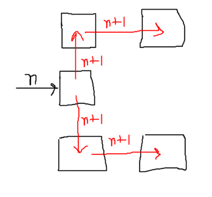

# Robot Odd Moves: DP Approach

## Observation

From a cell $(i, j)$ reached at the end of an operation, a single operation can only lead to the following cells below. The robot first moves up or down, then moves one step right, so the cells it can touch are:

- **Up branch:** $(i, j+1)$ -> $(i+1, j+1)$
- **Down branch:** $(i, j-1)$ -> $(i+1, j-1)$

Every receiving cell passes its value on in the same fixed pattern, so this is a grid DP where each cell interacts with its neighbours.



## State

`dp[i][j]` = minimum number of operations needed for the robot to visit the point $(i, j)$.

Since we are counting operations, the value is an integer, so:

```cpp
int dp[1002][1002];
```

The grid is $1002 \times 1002$ because $0 \le a, b \le 1000$ (with a small margin for the intermediate cells). It is precomputed once, and each test case is then answered by a lookup.

## Transition

For each cell, check whether the value propagated to a neighbour is smaller than what that neighbour already holds. For example, the cell $(i+1, j+1)$ receiving from $(i, j)$:

```cpp
dp[i+1][j+1] = min(dp[i+1][j+1], dp[i][j] + 1);
```

The same relaxation is applied to the other cells reachable in the pattern above.

## Base Case

```cpp
dp[0][0] = 0; 
```

## Answer

For each test case $(a, b)$:

- If `dp[a][b]` is still `INF`, print `-1`.
- Otherwise print `dp[a][b]`.


## Complexity

| | Cost |
|---|---|
| Precomputation | $O(N^2)$, with $N \approx 1002$ |
| Per test case | $O(1)$ |

## Reflection

This works, but it is inefficient/overkill. The grid precomputation is not needed, because the reachable cells follow a simple parity pattern. After $k$ operations the robot is at $x = k$ with $y \equiv k \pmod 2$ and $|y| \le k$, and the intermediate cells follow the same structure shifted by one. That gives an $O(1)$ formula per test case:

- if $b > a + 1$: answer is $-1$
- else if $(a - b)$ is even: answer is $a$
- else: answer is $a + 1$

I saw a DP like pattern during a Div1+2 contest and assumed it was pure DP without first checking whether any other solution could be possible
