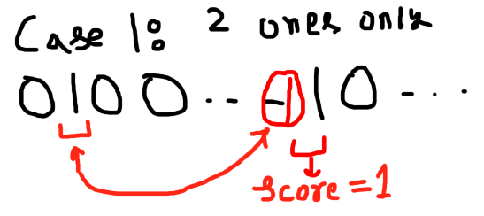
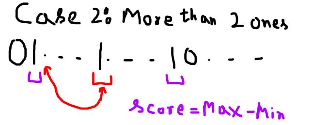
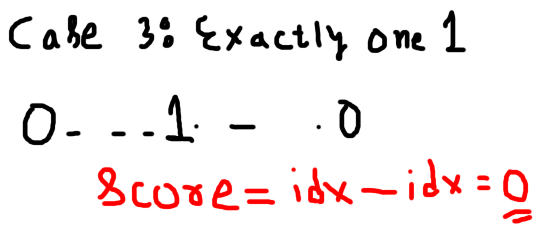

# Souvlakity vs Kalamakity

## Strategy

### Case 1: Exactly two `1`s

- **Souvlakity** gives away its lower-indexed `1`.
- **Kalamakity** gives away the `0` closest to the remaining `1`. This is always at distance 1 (adjacent), so the score is always **1**.

### Case 2: More than two `1`s

- **Souvlakity** gives away the **middle** `1`.
- **Kalamakity** must give that same `1` back, and it must lie between the extreme `1`s. If it doesn't, the max/min changes in Kalamakity's favour.
- The final score is simply `max - min` of the initial state.

### Case 3: Exactly one `1`

- **Souvlakity** has only one move: give away its only `1`, which is forced.
- **Kalamakity** can give back any of its `0`s. The final position always has exactly one `1`, so the score is `idx - idx = 0`.
