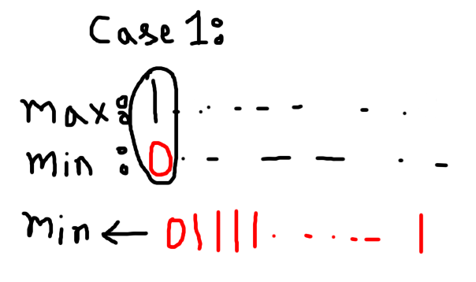
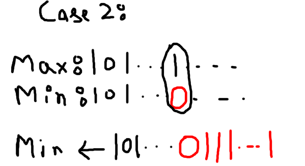

# B. What's the Capital of France?

> **Note:** This problem was upsolved after the contest. I didn't solve it during the contest.

## Observation

The delicacy is the OR of all ratings, so each bit we can switch on adds to the answer. Only the maximum and minimum ratings matter. Let `maxt` and `mint` be these two values. Every other rating can be ignored, since the operations let the minimum element grow toward the maximum's bit pattern, and the highest bit of the OR is already set by the maximum.

Let `a` be the bit length of `maxt` and `b` be the bit length of `mint`. The highest bit of `maxt` is at position `a - 1`.

## Case 1: Same bit length (`a == b`)

The maximum and minimum share their highest bit. Let `i` be the highest position below the top where they differ. At that position the maximum has a `1` and the minimum has a `0`.

The minimum can be pushed upward so that its bits below position `i` all become `1`, keeping the shared prefix above it. The OR then gains every bit below `i`, so the answer is:

`maxt | ((1 << i) - 1)`

If no such differing position exists (for example `n = 1`, or all values are equal), no bits can be gained, and the answer is simply `maxt`.

## Case 2: Different bit lengths (`a > b`)

The minimum is shorter than the maximum, so it has a lower highest bit. The minimum can be pushed up until its bits fill every position below the maximum's top bit. Every bit under the top bit then becomes `1`, so the answer is:

`maxt | ((1 << a) - 1)`

**Complexity:** O(n) time and O(1) extra memory per test case.
